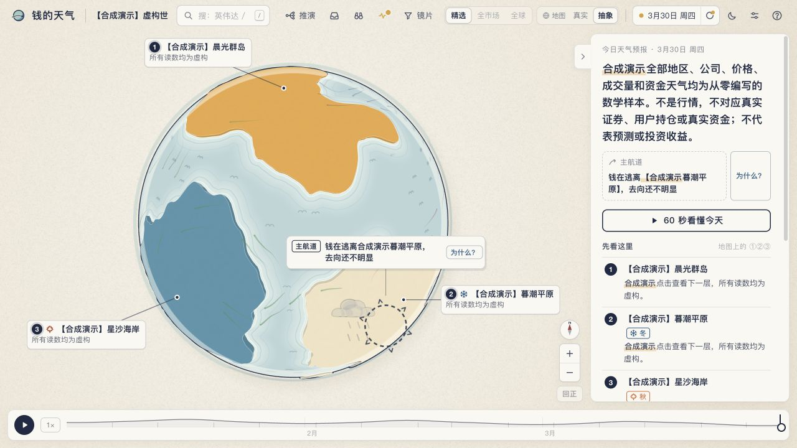
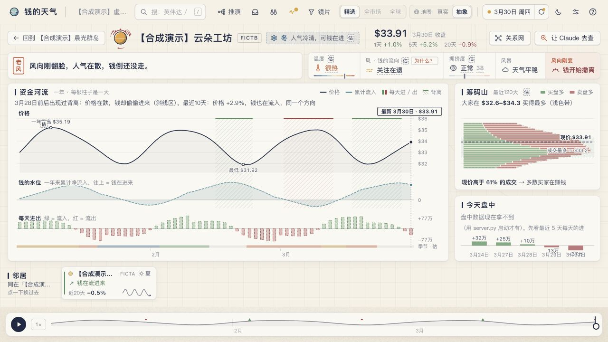

# 钱的天气 · Money Weather

把复杂的市场数据变成可逐层探索的天气地图，并把 AI 解释、情景推演和证据核验放在同一条用户流程中。

个人 AI 辅助开发项目，使用 Python 本地服务和 JavaScript 前端。它是产品与工程实践展示；不连接券商、不执行交易。公开副本保留实现代码，行情下载缓存、个人持仓、历史提问、推演、账本、日志和本机配置均未上传。

## 先看演示

需要 Python 3.10 或更新版本。合成演示用静态服务，只需要 Python 标准库；不需要 API 密钥，不连接后台 API、不调用 Claude、不更新真实行情。

```sh
python3 scripts/create_demo.py
python3 -m http.server 8765 --bind 127.0.0.1 --directory web
```

打开 **http://127.0.0.1:8765/?data=demo**。

页面里的演示名称和数值都是合成数据，用于检查地图、时间轴、层级导航和详情交互。演示不代表实测市场表现；AI 原因卡和推演在静态演示中不可用，需要另行配置后端；未用虚构回答代替真实模型结果。





## 已实现的产品结构

- **逐层探索**：世界、地区／主题、个股，支持时间轴、搜索、2D／3D、日夜主题和导览。
- **测量与解释分开**：价格、资金流估算、数据来源及更新时间由数据管线处理；AI 负责解释和提出待验证线索，不覆写原始测量。
- **“为什么”原因卡**：先整理日期、变化幅度和对比事实，再调用 Claude 搜索；输出原因、反方、来源与后续观察项。
- **情景推演**：输入带日期的假设，分阶段整理因果链和可能落点，并保存认错条件和后续跟踪记录。
- **统一 AI 调用出口**：预算预占、实际成本和 token 记账、结构化输出校验、有限重试、结果缓存、禁用开关。
- **后台任务**：更新调度、心跳、数据新鲜度检查、失败记录与恢复。后台不会自行修改源码。

这些是本地个人项目的实现范围，不等于独立完成全部代码、生产部署或外部用户验证。代码主要借助 AI 编程完成。

## 目录

| 路径 | 用途 |
|---|---|
| `server.py` | 本地 HTTP 服务和 API；默认绑定 localhost |
| `web/js/`、`web/css/` | 交互界面、地图、详情与功能面板 |
| `common/claude_gate.py` | AI 调用、预算、输出校验和缓存 |
| `pipeline/` | 数据抓取、指标计算、文字生成与新鲜度 |
| `why/` | 事实整理、原因卡、任务状态 |
| `scenario/` | 情景推演、估值与跟踪 |
| `intel/`、`scout/` | 信息整理和带来源的研究任务 |
| `loop/` | 后台调度、健康检查、预算接口 |
| `flows/`、`liquidity/`、`macro/` | 资金流、流动性和宏观数据适配 |
| `globalmkt/`、`fullmarket/` | 全球／全市场数据构建 |
| `geodata/`、`graph/` | 地理信息与关系网构建 |
| `art3d/`、`web/assets/` | 自制三维视觉资源及生成脚本 |
| `scripts/create_demo.py` | 从零生成合成演示，无外部数据 |

## 运行真实数据或 AI 功能

演示之外的数据处理需要安装对应可选依赖，见 `requirements-data.txt`；Blender 资源重建还需要 Blender 自带的 Python 环境。部分地理处理需要额外原始数据，由构建脚本获取，公开仓库不附带这些下载结果。

真实数据来源包括行情／ETF 发行商／公共宏观与预测市场接口，各自的可用性、许可和取用规则不同；请在自行启用前核对。数据缺失、延迟、盘中估算与结构化映射都可能影响结果，不能把资金流估算当作实际申赎金额。

完整后端使用 `MW_CLAUDE_DISABLED=1 python3 server.py --host 127.0.0.1 --port 8765 --no-loop` 启动，以便先检查 API，保持 AI 禁用和后台循环关闭。AI 通过使用者本机已登录的 Claude CLI 调用；需要使用时，由运行者自行配置 CLI、预算与数据源。`common/budget.example.json` 是公开的保守配置示例，不含作者个人账本，只有自行复制为 `common/budget.json` 后才生效。

不要把此本地服务直接暴露到公网；它为单人 localhost 使用设计，没有多用户身份与权限层。

## 本地检查

```sh
python3 common/selftest.py
```

该项使用临时目录与假的 Claude 程序，验证调用出口的解析、成本、并发预算与失败行为，不花模型额度。它不能证明整套系统的数据正确性或投资效果。

## 公开范围与许可

这是经过清理的代码展示副本，与个人运行目录分开维护。原始内部设计笔记、用户级配置与真实数据输出未发布。

项目代码暂未指定开放源代码许可证。第三方代码、字体与资产遵循各自许可，见 `THIRD_PARTY_NOTICES.md`；公开展示不改变这些许可。
